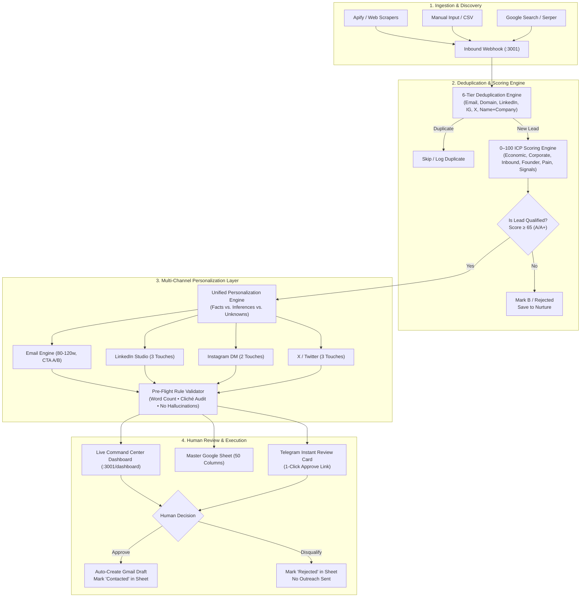

# Executive Lead Intake & Triage System: Complete Architectural & Presentation Blueprint

> **System Mission**: An enterprise-grade, human-controlled outbound intelligence and inquiry triage system designed specifically for high-ticket executive coaches, corporate consultants, and boutique advisory practices ($10k–$50k+ engagements).

---

## 1. Executive Summary & Problem Hypothesis

### The Problem in the Market
Senior executive coaches and corporate leadership consultants make **\$10,000 to \$50,000+** per client engagement. However, they almost always suffer from the **"Triage Drag"**:
1. **Intense Delivery Weeks**: They spend entire days facilitating C-suite offsites, keynote speaking, or coaching VP-level leaders.
2. **Inbox Bottleneck**: While they are offline in sessions, incoming inquiries arrive through website contact forms, LinkedIn DMs, or general inboxes.
3. **Admin Burnout**: After hours of high-touch coaching, the last thing they have energy for is sorting through 20 inquiries to see who is an enterprise buyer vs. who is a tire-kicker.
4. **Fear of Uncontrolled AI**: They refuse to let generic "AI SDR bots" autonomously email their prestigious corporate prospects with cheesy, hallucinated messages that destroy their reputation.

### The Solution We Built
An **Executive Lead Intake & Triage System**:
- It ingests and qualifies corporate prospects using **strict factual evidence**.
- It evaluates their economic fit (0–100 ICP scoring).
- It produces a **Qualification Brief** for human review.
- It prepares bespoke, channel-native messaging across **all 4 platforms (Email, LinkedIn, Instagram, X)**.
- **Nothing is ever sent without explicit human approval.**

```
"You shouldn't have to become your own admin clerk between client sessions."
```

---

## 2. End-to-End Architecture & Data Pipeline

The entire system operates as a single, connected pipeline:



---

## 3. Component Breakdown: What Was Built & What Their Jobs Are

### Subsystem 1: Ingestion & Discovery Layer
* **Files**: [`src/discovery/search-scraper.ts`](file:///Users/rusan/Documents/Google%20anti-gravity%20projects/lead-gen-system/src/discovery/search-scraper.ts), [`src/webhook-server.ts`](file:///Users/rusan/Documents/Google%20anti-gravity%20projects/lead-gen-system/src/webhook-server.ts)
* **What It Is**: The entry gateway that accepts raw prospect leads from Apify scrapers, Google searches, CSV imports, or webhook POSTs.
* **How It Was Created**: Built on Node.js/TypeScript using native HTTP endpoints and structured JSON parsers.
* **Its Job**: Normalizes diverse raw payloads (names, websites, company names, snippets, social URLs) into a standardized `ProspectMasterRecord`.

---

### Subsystem 2: 6-Tier Deduplication Engine
* **Files**: [`src/dedup/dedup-engine.ts`](file:///Users/rusan/Documents/Google%20anti-gravity%20projects/lead-gen-system/src/dedup/dedup-engine.ts), n8n Code Node 5
* **What It Is**: An automated gatekeeper that guarantees no prospect ever receives duplicate outreach.
* **How It Was Created**: A cascading hierarchy of clean string/regex comparisons checking the entire existing database before any processing occurs.
* **Its Job**: Evaluates 6 sequential tiers:
  1. **Tier 1**: Exact Normalized Email match.
  2. **Tier 2**: Root Company Domain match (strips `https://`, `www.`, subpaths).
  3. **Tier 3**: LinkedIn Profile Slug match.
  4. **Tier 4**: Instagram Handle match.
  5. **Tier 5**: X / Twitter Handle match.
  6. **Tier 6**: Cleaned Full Name + Company string match.

---

### Subsystem 3: 0–100 Deterministic ICP Scoring Engine
* **Files**: [`src/scoring/scoring-engine.ts`](file:///Users/rusan/Documents/Google%20anti-gravity%20projects/lead-gen-system/src/scoring/scoring-engine.ts), n8n Code Node 7
* **What It Is**: An objective algorithmic evaluator that scores prospects based on verified business signals rather than AI guesswork.
* **How It Was Created**: Six weighted scoring categories totaling 100 points:
  * **Economic Value (0–25 pts)**: Verified \$25k+ corporate retainers = 25 pts, \$10k–\$25k = 20 pts, <\$5k = 0–5 pts.
  * **Corporate Focus (0–20 pts)**: Enterprise C-suite/VP focus vs. consumer life coaching.
  * **Inbound Friction / Potential (0–10 pts)**: Presence of active contact forms, applications, or speaking tours.
  * **Founder-Led Sales (0–10 pts)**: Founder/Managing Partner handles corporate inbounds personally.
  * **Operational Pain (0–15 pts)**: High triage latency between delivery sessions.
  * **Buying Signals (0–20 pts)**: Cohort launches, keynotes, summit appearances, hiring.
* **Its Job**: Assigns a tier:
  * **Tier 1 (A+) (Score 80–100)**: Immediate priority; high-ticket corporate retainer.
  * **Tier 2 (A) (Score 65–79)**: Qualified B2B practice.
  * **Tier 3 (B) (Score 50–64)**: Mid-market; hold for nurture.
  * **Disqualified (<50)**: Rejected; stops processing immediately.

---

### Subsystem 4: Multi-Channel Outbound Personalization Engine
* **Files**: [`src/outreach/personalization.ts`](file:///Users/rusan/Documents/Google%20anti-gravity%20projects/lead-gen-system/src/outreach/personalization.ts), [`src/ai/prompts.ts`](file:///Users/rusan/Documents/Google%20anti-gravity%20projects/lead-gen-system/src/ai/prompts.ts), [`src/ai/openrouter.ts`](file:///Users/rusan/Documents/Google%20anti-gravity%20projects/lead-gen-system/src/ai/openrouter.ts)
* **What It Is**: The core messaging engine that crafts tailored outreach across **all 4 platforms**.
* **How It Was Created**: 
  * Powered by OpenRouter AI (`nvidia/nemotron-3-super-120b`, Claude 3.5 Sonnet, or GPT-4o) with an automated deterministic fallback engine for 100% uptime.
  * Uses one unified intelligence layer ingesting 21 data points:
    * First name, company, website, LinkedIn, Instagram, X, country, niche, offer, audience, scores, lead capture mechanism, recent signals, verified evidence, inferences, unknowns, personalization angle, and recommended channel.
* **Its Job**: Generates platform-native messages:
  1. **Email (80–120 Words)**:
     * *Structure*: Subject → Specific observation → Problem hypothesis → Executive lead intake explanation → Human-review guarantee → Low-friction CTA.
     * *A/B Testing*: Automatically alternates between:
       * **CTA A**: *"Worth sending over a 2-minute breakdown?"*
       * **CTA B**: *"Would it be useful if I sent you a 2-minute example?"*
  2. **LinkedIn (3-Touch Sequence)**:
     * *Connection Note*: Short, under 300 characters, no sales pitch dump.
     * *First Message*: Conversational, referencing their recent post or executive advisory focus.
     * *Follow-Up*: Introduces the Executive Lead Intake system with a native low-friction CTA.
  3. **Instagram (2-Touch Sequence)**:
     * *First DM*: Natural, professional DM starting a real dialogue.
     * *Follow-Up*: Introduces the solution.
  4. **X / Twitter (3-Touch Sequence)**:
     * *Public Opener / Reply*: Adds insight to their post without selling.
     * *Direct Message (DM)*: Concise offer introduction.
     * *Follow-Up*: Brief check-in.
  5. **Missing Channels**:
     * If a prospect lacks a social profile, returns `"status": "not_recommended"` rather than inventing messages.

---

### Subsystem 5: Pre-Flight Rule Validator
* **Files**: [`src/outreach/personalization.ts:validateOutreach`](file:///Users/rusan/Documents/Google%20anti-gravity%20projects/lead-gen-system/src/outreach/personalization.ts#L170)
* **What It Is**: An automated quality assurance firewall that reviews copy *before* it reaches the human review stage.
* **How It Was Created**: Strict regex, word-counter, and cliché-auditor.
* **Its Job**:
  * **Word Count Check**: Flags emails outside the 80–120 word range.
  * **Banned Buzzword Audit**: Disallows clichés like:
    * `"hope this email finds you well"`, `"synergy"`, `"cutting-edge"`, `"game-changer"`, `"streamline"`, `"leverage"`, `"delve"`, `"testament"`, `"supercharge"`, `"revolutionary"`, `"AI CRM"`, `"AI sales automation"`.
  * **Fabricated Claim Audit**: Prevents unverified ROI numbers, fabricated team sizes, or fake lead volumes.

---

### Subsystem 6: Multi-Channel Sequencing & Stop-on-Reply Guardrail
* **Files**: [`src/outreach/personalization.ts:recommendSequence`](file:///Users/rusan/Documents/Google%20anti-gravity%20projects/lead-gen-system/src/outreach/personalization.ts#L399)
* **What It Is**: The cadence scheduler that spaces out touchpoints over 12 days.
* **Its Job**:
  * **Day 1**: Personalized Email
  * **Day 3**: LinkedIn Connection Note
  * **Day 6**: LinkedIn First Message / Follow-up
  * **Day 9**: Email Follow-up
  * **Day 12**: Optional Social touchpoint (Instagram or X)
  * **Hard Rule (Stop-on-Reply)**: If the prospect replies on *any* channel, all automated follow-ups stop immediately and the lead is marked `REPLIED` for human handling.

---

### Subsystem 7: Master Google Sheet & Live Visual Command Center
* **Google Sheet**: [`Master_Prospects` (50 Columns)](https://docs.google.com/spreadsheets/d/YOUR_GOOGLE_SHEET_ID/edit)
* **Web Dashboard**: [`http://localhost:3001/dashboard`](http://localhost:3001/dashboard)
* **What It Is**: The user-facing control deck where you and your team review, inspect, copy, and approve outreach.
* **Features Built**:
  * **Live KPI Bar**: Total pipeline, A+ qualified count, review queue, contacted count, qualification rate.
  * **Interactive Filter Tabs**: Filter by `All Leads`, `Review Queue`, `🌟 A+ Tier`, `Contacted`, `Rejected`.
  * **Real-Time Search**: Search by name, company, offer, or keywords without reloading.
  * **Multi-Channel Studio**: Tabbed viewer on every lead card with instant `Copy` buttons for:
    * Email Subject & Body
    * LinkedIn Connection Note, First Message, Follow-up
    * Instagram DMs
    * X Opener & DMs
    * 12-Day Cadence Plan
  * **1-Click Actions**:
    * `✅ Approve & Create Gmail Draft`: Creates a draft directly in your Gmail inbox, ready to send.
    * `❌ Disqualify`: Marks rejected and halts all activity.

---

## 4. Data Contract: Verified Facts vs. Inferences vs. Unknowns

The system strictly enforces a 3-part evidence protocol:

| Evidence Type | Definition | Example in System |
| :--- | :--- | :--- |
| **VERIFIED FACT** | Explicitly stated in the source text or verified company domain. | *"Company: Sterling Executive Advisory; Offer: Bespoke 6-Month Retainer (\$35k); Verified Domain: sterlingadvisory.com"* |
| **INFERENCE** | A logical deduction reasoned from verified facts. | *"Founder likely conducts high-touch delivery personally between offsites, causing inquiry triage drag."* |
| **UNKNOWN** | Missing information that must never be fabricated. | *"Exact weekly inbound inquiry volume; internal triage process duration."* |

---

## 5. Step-by-Step Presentation & Demo Script (For You & Your Friend)

Here is how you can present this project to your friend:

### Step 1: Open the Live Operational Dashboard
Open **[http://localhost:3001/dashboard](http://localhost:3001/dashboard)** in your browser.
* **Point out**:
  * The top KPI bar showing real pipeline metrics.
  * The status pill showing the local webhook and n8n services actively running.
  * The real-time search box: type in *"Sterling"* or *"Vance"* to show how it filters instantly.

### Step 2: Show a Real A+ Prospect Card (e.g. David Sterling)
* **Show the ICP Score Breakdown**: Point out the 6 deterministic criteria:
  * Econ: 25/25 (verified \$35k retainer)
  * Corp: 20/20 (Fortune 500 C-suite)
  * Total Score: **86/100 (Tier A+)**
* **Show the Evidence Drawer**: Show that the AI distinguishes between Verified Facts, Inferences, and Unknowns without making up fake claims.

### Step 3: Demonstrate the Multi-Channel Outreach Studio
Click through the channel tabs on the card:
1. **✉️ Email**: Show the 88-word email, the subject line, the specific observation about their keynote/cohort, and the tested CTA. Click **Copy Body** to show the copy feedback.
2. **💼 LinkedIn**: Click over to show the 3-step sequence (Connection note under 300 chars, conversational first message, value follow-up).
3. **📸 Instagram & 🐦 X**: Show that because this prospect has no Instagram or X profile, the system displays `[NOT RECOMMENDED]` instead of sending spam.
4. **🗓 Cadence**: Show the 12-day multi-channel roadmap and explain the **Stop-on-Reply** rule.

### Step 4: Show the Google Sheet Database
Open the **[Master Google Sheet](https://docs.google.com/spreadsheets/d/YOUR_GOOGLE_SHEET_ID/edit)**:
* Show columns **AI through AM**:
  * Column AI: `Recommended Channel`
  * Column AJ: `Draft Email`
  * Column AK: `Draft LinkedIn Message`
  * Column AL: `Draft Instagram Message`
  * Column AM: `Draft X Message`
* Explain how every single prospect has their complete multi-channel campaign pre-staged in the spreadsheet.

### Step 5: Demonstrate Ingestion & 1-Click Human Approval
1. Click the **"+ Ingest Test Lead"** button at the top of the dashboard.
2. Watch a new high-ticket advisory lead get ingested, scored, and written to the database.
3. Click **"✅ Approve & Create Gmail Draft"**: show that the system safely creates a draft in Gmail for review without sending anything autonomously.

---

## 6. Key Technical & Commercial Defensibility

When presenting this to peers, clients, or investors, highlight these advantages:

1. **No Hallucinations**: Most AI outbound tools invent case studies, fake ROI, and fake pain. This system uses strict **evidence attribution** (Verified Fact vs. Inference vs. Unknown).
2. **Channel-Native**: It does not copy-paste emails into LinkedIn or Instagram. Each channel has its own character limits, formatting, and psychological pacing.
3. **Human-in-the-Loop Safety**: For \$10k–\$50k enterprise coaching deals, an automated bot sending weird messages will kill deals. This system prepares response briefs and drafts, leaving the executive in 100% control.
4. **Complete Local Ownership**: Running on your local machine with n8n and TypeScript means zero recurring SaaS subscription fees, no platform lock-in, and unlimited execution capacity.
