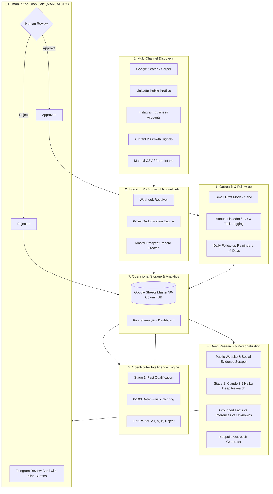

# Executive Lead Intake & Triage System

> **Commercial Positioning**: An executive lead-intake system for boutique coaching and advisory practices ($10k–$50k+ engagements). Turns incoming inquiries into a qualification brief, prioritizes stronger opportunities, and prepares response drafts for human review before your inbox.

---

## ⚡ Quick Restart Commands (When You Re-Open)

```bash
# 1. Start n8n Local Engine (Port 5678)
N8N_PORT=5678 N8N_HOST=localhost N8N_WEBHOOK_URL=http://localhost:5678/ ~/node/bin/n8n start

# 2. Start Webhook Server & Live Dashboard (Port 3001)
npm run server
```

* **Live Command Dashboard**: [http://localhost:3001/dashboard](http://localhost:3001/dashboard)
* **n8n Automation Console**: [http://localhost:5678](http://localhost:5678)
* **Master Google Sheet**: [Master_Prospects Google Sheet](https://docs.google.com/spreadsheets/d/YOUR_GOOGLE_SHEET_ID/edit)
* **Presentation Blueprint**: [`docs/Executive_Lead_Intake_System_Presentation_Blueprint.md`](docs/Executive_Lead_Intake_System_Presentation_Blueprint.md)
* **Complete System Restart Guide**: [`docs/SYSTEM_RESTART_GUIDE.md`](docs/SYSTEM_RESTART_GUIDE.md)

---: Production Lead Generation & Intelligence Engine

A production-grade, evidence-based B2B lead generation, qualification, and human-in-the-loop triage system engineered for **Executive Coaches, Leadership Consultants, Corporate Trainers, and High-Ticket Advisory Firms**.

The system is architected for **Make.com** orchestration, **Google Sheets** operational database, **OpenRouter** AI intelligence, **Telegram** human-in-the-loop approval, and **Gmail** safe dispatch—built from day one to operate near **$0 cost** on free tiers.

---

## 1. System Architecture



---

## 2. Target ICP & Commercial Positioning

### Target ICP
- **Who we target:** Executive Coaches, Leadership Development Consultants, Corporate Leadership Trainers, High-Ticket Advisory Firms.
- **Engagement Economics:** High-ticket corporate retainers ($10k – $50k+).
- **Firm Structure:** Founder-led, Managing Partners, or boutique practices handling client acquisition directly.
- **Inbound Friction:** General contact form, unstructured free-text inquiries, or severe triage delay between intense corporate offsites and keynotes.
- **Who we strictly avoid:** Low-ticket consumer life coaches ($150/hr), hobbyists, career coaches without corporate enterprise offers.

### Commercial Positioning (Never Sell "AI")
- **The Core Problem:** Senior leadership advisors leave $25k+ opportunities unanswered or lose hours between client offsites reading exploratory inquiries.
- **The Angle:** *"You shouldn't have to become your own admin clerk between client sessions."*
- **The Solution:** Every corporate inquiry is analyzed, prioritized by budget and corporate fit, and prepared with a personalized response before you open your inbox—while keeping the human 100% in control.

---

## 3. Strict 6-Tier Deduplication Engine

The same executive may appear across Google, LinkedIn, Instagram, and X. The deduplication engine guarantees **one single canonical record** with all profile links merged:

1. **Tier 1:** Normalized Email (`lead2@example.com`)
2. **Tier 2:** Root Website Domain (`sterlingadvisory.com`, stripping `www`, query params, trailing slashes)
3. **Tier 3:** LinkedIn Profile Handle (`/in/davidsterling-exec`)
4. **Tier 4:** Instagram Username (`@davidsterling`)
5. **Tier 5:** X/Twitter Handle (`@davidsterling`)
6. **Tier 6:** Normalized Name + Company (`davidsterling__sterlingadvisory`)

---

## 4. Deterministic 0–100 Prospect Qualification Scoring

Scores are deterministic and grounded in verified evidence (not hallucinated):

| Component | Max Points | Scoring Criteria |
| :--- | :---: | :--- |
| **Economic Value** | **25** | Verified $25k+ retainer = 25; $10k–$25k = 20–25; $5k–$10k = 10; <$5k = 0–5 |
| **Corporate Focus** | **20** | C-Suite, VP, Fortune 500/FTSE focus = 20; Corporate B2B teams = 15; Consumer life coaching = 0 |
| **Inbound Potential** | **10** | Live application/inquiry system + active content/cohorts = 10; Static form = 6 |
| **Founder-Led Sales** | **10** | Founder/Principal personally reviews inquiries and handles sales = 10; Boutique owner = 8 |
| **Operational Pain** | **15** | General free-text contact form + visible triage latency (travel/training) = 15; Basic form = 10 |
| **Buying / Growth Signals**| **20** | New program launch, open executive cohort, or public notice of inquiry backlog = 20 |
| **TOTAL** | **100** | **A+ (80–100) \| A (65–79) \| B (50–64) \| Reject (<50)** |

---

## 5. Make.com Modular Scenario Blueprints

Located in `make-blueprints/`, ready for 1-click import into **eu2.make.com**:

1. **`scenario_1_prospect_ingestion.json`:** Receives webhooks from Apify/Serper/Sheets, deduplicates across 6 tiers, and creates `Status = Raw`.
2. **`scenario_2_initial_qualification.json`:** Watches `Raw` leads, runs OpenRouter Stage 1 Fast Model (`gpt-4o-mini`), computes 0-100 score, assigns tier.
3. **`scenario_3_deep_research.json`:** Scrapes public website for A/A+ leads, runs Claude 3.5 Haiku, extracts verified evidence vs inferences vs unknowns.
4. **`scenario_4_outreach_generation.json`:** Crafts personalized email and social copy, transitions lead to `Ready for Review`.
5. **`scenario_5_telegram_human_approval.json`:** Sends rich Telegram card with Inline `[Approve]` / `[Reject]` buttons; captures human callback.
6. **`scenario_6_approved_outreach_dispatch.json`:** Creates safe Gmail Draft or logs manual LinkedIn task; marks `Status = Contacted`.
7. **`scenario_7_followup_and_analytics.json`:** Daily 9:00 AM check for untouched leads (>4 days) and sends gentle follow-up prompts.

---

## 6. Directory Layout & Key Files

```
lead-gen-system/
├── .env.example                       # Central environment variables & limits
├── .env                               # Active configuration
├── package.json                       # Dependencies & CLI commands
├── tsconfig.json                      # Strict TypeScript compiler options
├── data/
│   ├── master_prospects.json          # Persistent JSON database
│   └── master_prospects.csv           # 50-column Google Sheets mirror CSV
├── make-blueprints/
│   ├── scenario_1_prospect_ingestion.json
│   ├── scenario_2_initial_qualification.json
│   ├── scenario_3_deep_research.json
│   ├── scenario_4_outreach_generation.json
│   ├── scenario_5_telegram_human_approval.json
│   ├── scenario_6_approved_outreach_dispatch.json
│   ├── scenario_7_followup_and_analytics.json
│   └── README_MAKE_SETUP.md          # Visual Make.com import guide
├── templates/
│   ├── google_sheets_master_template.csv # 50-column template with sample record
│   └── google_sheets_formulas.md     # Analytics formulas & conditional formatting
├── src/
│   ├── config.ts                     # Central configuration & thresholds
│   ├── types.ts                      # Full TypeScript interfaces
│   ├── db/
│   │   ├── schema.ts                 # 50-column schema definitions & mappers
│   │   ├── sheets-client.ts          # Database client with disk & CSV sync
│   │   └── seed-data.ts              # Curated seed leads
│   ├── dedup/
│   │   └── dedup-engine.ts           # 6-tier deduplication engine
│   ├── scoring/
│   │   └── scoring-engine.ts         # Deterministic 0-100 scoring model
│   ├── ai/
│   │   ├── prompts.ts                # Structured JSON prompt templates
│   │   ├── schema-validator.ts       # Strict JSON validator & sanitizer
│   │   └── openrouter.ts             # OpenRouter client with retries & offline fallback
│   ├── discovery/
│   │   ├── google-serper.ts          # Google search multi-query scraper
│   │   └── apify-discovery.ts        # Apify public actor wrappers
│   ├── outreach/
│   │   ├── personalization.ts        # Anti-flattery, evidence-grounded copy drafter
│   │   ├── telegram-approval.ts      # Telegram notification & callback service
│   │   └── gmail-dispatcher.ts       # Gmail draft safety & social task logger
│   ├── analytics/
│   │   └── analytics-engine.ts       # Funnel velocity, conversion & channel ROI
│   └── index.ts                      # Master pipeline controller & CLI runner
└── tests/
    └── e2e-lead-gen.test.ts          # Complete end-to-end test suite
```

---

## 7. How to Run the System

### 1. Run Complete End-to-End Test Suite
```bash
cd "~/Documents/Google anti-gravity projects/lead-gen-system"
npm test
```
*Executes all 8 stages: discovery -> deduplication -> scoring -> qualification -> deep research -> Telegram review card -> Gmail draft -> funnel analytics.*

### 2. Run Live Ingestion & Qualification Pipeline
```bash
npm run qualify
```

### 3. View Funnel Analytics Dashboard
```bash
npm run analytics
```

### 4. Run Targeted Discovery
```bash
npm run discover:google
npm run discover:apify
```

---

## 8. Free-Tier Economics ($0 Baseline)

| Service | Free Tier Allowance | System Usage (100 Leads) | Monthly Cost |
| :--- | :--- | :--- | :---: |
| **Make.com** | 1,000 operations/month | ~400 operations | **$0.00** |
| **Google Sheets** | Unlimited | Master operational database | **$0.00** |
| **OpenRouter (`gpt-4o-mini`)** | Pay-as-you-go ($0.15/1M tokens) | ~150,000 tokens for 100 leads | **~$0.02** |
| **OpenRouter (`claude-3.5-haiku`)**| Pay-as-you-go ($0.80/1M tokens) | ~100,000 tokens for 30 A/A+ leads | **~$0.08** |
| **Serper (Google Search)** | 2,500 free queries | ~20 queries | **$0.00** |
| **Apify** | $5.00 free monthly credit | ~50 actor runs | **$0.00** |
| **Telegram Bot API** | 100% Free | Instant review cards | **$0.00** |
| **Gmail** | 100% Free (500 emails/day) | Safe inbox drafts | **$0.00** |
| **TOTAL INITIAL RUN COST** | | | **~$0.10** |
